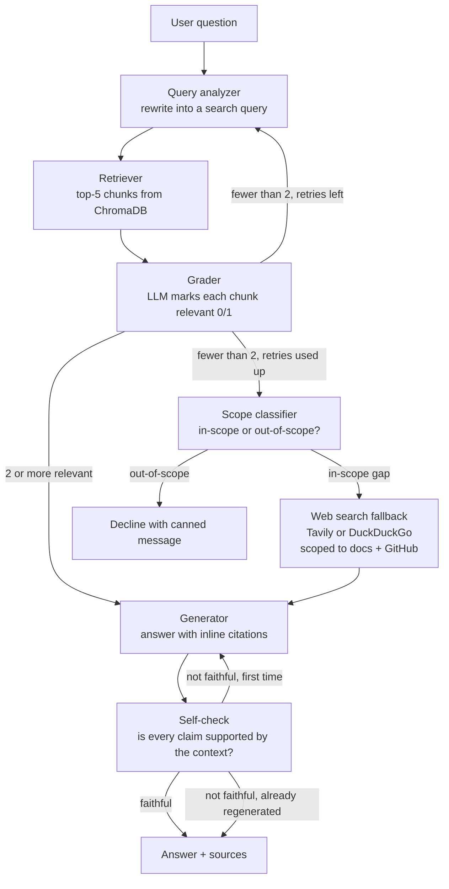
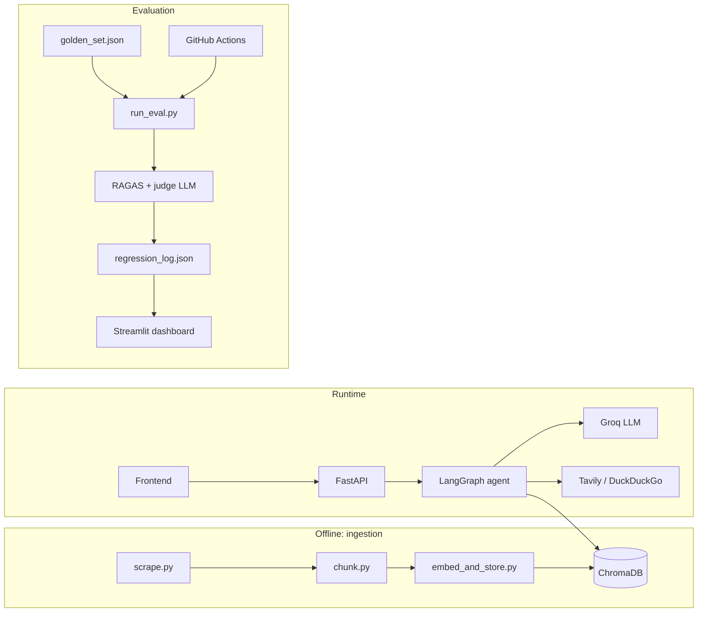

# GraphQA-Sentinel

A self-correcting RAG agent over the FastAPI documentation, with a continuous evaluation harness.

Unlike plain retrieve-then-generate RAG, GraphQA-Sentinel grades its own retrieval, rewrites the query and retries when retrieval is weak, classifies out-of-scope questions and declines them, falls back to a scoped web search for genuine retrieval gaps, and fact-checks its own draft answer against the retrieved context before responding.

## Status

| Milestone | State |
|---|---|
| M1 Ingestion pipeline | Done |
| M2 Baseline RAG | Done |
| M3 Golden evaluation set (47 questions) | Done |
| M4 Eval harness (RAGAS) | Done |
| M5 Agentic LangGraph pipeline | Done |
| M6 Regression log + Streamlit dashboard | Done |
| M7 CI gate | Workflow in place |
| M8 Docker | Done and verified locally |
| M9 README | This file |

## Architecture

### Agent graph



- **Query analyzer** rewrites the question into a retrieval-friendly query. On a retry it is told the previous query failed and asked for a genuinely different angle.
- **Grader** makes one batched LLM call that marks each retrieved chunk relevant or not. Malformed output fails safe — all chunks count as irrelevant, routing to a retry.
- **Scope classifier** runs after retries are exhausted. If the question is primarily about a technology other than FastAPI (Kubernetes, Terraform, Redis, Next.js, etc.), the system declines with a canned message instead of falling back to web search.
- **Web fallback** uses Tavily when `TAVILY_API_KEY` is set and a DuckDuckGo scrape otherwise, restricted to the docs domain and GitHub. Only reached for genuine FastAPI retrieval gaps.
- **Generator** answers only from the supplied context and cites chunks inline as `[1]`, `[2]`.
- **Self-check** asks whether every claim in the draft is supported by the context. If not, the answer is regenerated once with a stricter prompt.

### System overview



## Tech stack

| Layer | Choice |
|---|---|
| Orchestration | LangGraph |
| App LLM | Groq, `openai/gpt-oss-120b` |
| Embeddings | `BAAI/bge-small-en-v1.5` via sentence-transformers (local) |
| Vector store | ChromaDB (local persistence) |
| API | FastAPI |
| Frontend | Single-page vanilla HTML/CSS/JS |
| Ingestion | requests + BeautifulSoup + trafilatura |
| Web fallback | Tavily, with DuckDuckGo scrape as fallback |
| Evaluation | RAGAS (faithfulness, answer relevancy, context precision, context recall) |
| Dashboard | Streamlit + Plotly |
| CI | GitHub Actions |
| Packaging | Docker |

## Repository structure

```
GraphQA-Sentinel/
├── ingestion/
│   ├── scrape.py              # sitemap crawl + trafilatura extraction to Markdown
│   ├── chunk.py               # split on Markdown headings, ~450-word chunks, 60-word overlap
│   ├── embed_and_store.py     # embed and write to Chroma with url/title/section metadata
│   └── verify_ingestion.py    # manual retrieval sanity check
├── agent/
│   ├── graph.py               # LangGraph state machine
│   ├── nodes.py               # all nodes: query analyzer, retriever, grader, scope classifier, generator, self-check, routers
│   └── tools.py               # web search fallback (Tavily / DuckDuckGo)
├── api/
│   ├── main.py                # FastAPI app: /chat, /chat/baseline, /health, static frontend
│   └── rag_pipeline.py        # baseline retrieve-then-generate pipeline
├── frontend/
│   ├── index.html
│   └── style.css
├── eval/
│   ├── golden_set.json        # 47 hand-written Q/A pairs
│   ├── run_eval.py            # runs the golden set and scores with RAGAS
│   ├── metrics.py             # RAGAS metric wiring + judge LLM configuration
│   └── store.py               # append-only regression log
├── dashboard/
│   └── app.py                 # Streamlit trend dashboard
├── .github/
│   ├── workflows/eval.yml     # CI eval gate
│   └── scripts/check_regression.py
├── Dockerfile
├── requirements.txt
└── .env.example
```

## Setup

### Prerequisites

- Python 3.12+ (on Windows with Python 3.14, `ragas` pulls in `scikit-network`, which needs the Microsoft C++ Build Tools to compile from source).
- A [Groq](https://console.groq.com) API key.
- Optional: a [Tavily](https://tavily.com) API key for the web fallback.

### Install

```bash
git clone https://github.com/<your-username>/GraphQA-Sentinel.git
cd GraphQA-Sentinel
python -m venv venv
source venv/bin/activate        # Windows: venv\Scripts\activate
pip install -r requirements.txt
cp .env.example .env
```

### Environment variables

| Variable | Required | Purpose |
|---|---|---|
| `GROQ_API_KEY` | yes | Groq API key (app LLM and eval judge) |
| `GROQ_MODEL` | recommended | App LLM. Set explicitly — model availability on Groq free accounts changes |
| `JUDGE_MODEL` | optional | Judge model for RAGAS scoring |
| `TAVILY_API_KEY` | optional | Enables Tavily for web fallback; DuckDuckGo scrape used otherwise |
| `CHROMA_PERSIST_DIR` | optional | Vector store path. Default `./chroma_store` |

### Build the vector store

```bash
python ingestion/scrape.py
python ingestion/chunk.py
python ingestion/embed_and_store.py
```

### Run the app

```bash
uvicorn api.main:app --reload
```

Open http://localhost:8000.

- `POST /chat` — agentic pipeline (answer, sources, diagnostics).
- `POST /chat/baseline` — plain retrieve-then-generate.
- `GET /health` — liveness check.

### Run with Docker

```bash
docker build -t graphqa-sentinel .
docker run --env-file .env -p 8000:7860 graphqa-sentinel
```

### Evaluation

```bash
python -m eval.run_eval --label baseline --pipeline baseline --sample 12 --fresh
python -m eval.run_eval --label agentic  --pipeline agentic  --sample 12 --fresh
streamlit run dashboard/app.py
```

`--sample N` takes a stratified sample across question categories. `--retry-failed` resumes a partial run without regenerating already-scored questions. Each run appends one summary row to `eval/regression_log.json`, which the dashboard plots.

## Evaluation

**Golden set:** 47 hand-written Q/A pairs against the FastAPI docs — 16 factual, 17 multi-hop, and 14 out-of-scope. Out-of-scope questions should be declined, not answered. Some are deliberate false-premise traps (e.g. asking about FastAPI's "built-in ORM").

**Metrics (RAGAS):** faithfulness, answer relevancy, context precision, context recall. Faithfulness uses a custom 2-call scorer (see [Design decisions](#design-decisions)).

**Scoring note:** For questions the agentic pipeline correctly declines as out-of-scope, `answer_relevancy` and `context_precision` are excluded from the average (undefined when no answer/context is produced). `context_recall` is scored as 0 (no chunks retrieved). This makes the comparison fair: the agentic pipeline is evaluated on the questions it actually answers.

**CI gate:** `.github/workflows/eval.yml` runs a stratified 10-question subset on every push and compares faithfulness against the previous run. A drop of more than 5 points fails the build. A run in which fewer than 70% of questions score is treated as unreliable and does not write to the log.

### Results

Scored on a stratified 12-question sample (4 factual, 4 multi-hop, 4 out-of-scope).

| Metric | Baseline | Agentic | Change |
|---|---|---|---|
| Faithfulness | 0.753 | 0.737 | -0.016 |
| Answer relevancy | 0.620 | **0.909** | +0.289 |
| Context precision | 0.626 | **0.715** | +0.089 |
| Context recall | **0.597** | 0.542 | -0.055 |

The agentic pipeline wins clearly on answer relevancy and context precision. Faithfulness and context recall are within noise for a 12-question sample. The context recall gap is structural: the agentic grader filters out some chunks that RAGAS would count toward recall, trading recall for precision.

## Design decisions

| Original plan | What was built | Why |
|---|---|---|
| App LLM: Llama 3.3 70B or Qwen3 32B | `openai/gpt-oss-120b` on Groq | Neither model was available on the account used |
| Judge: Gemini 2.5 Flash | `qwen/qwen3.8-27b` on Groq | Gemini 2.5 Flash returned 404 for new keys; its successor had a 20 req/day free quota; RAGAS's Google adapter had bugs in the pinned version |
| RAGAS `Faithfulness` metric | Custom 2-call faithfulness scorer | RAGAS's NLI schema produces 800-1200 output tokens per question, exceeding the 1,000 OTPM cap on Groq free tier. The custom scorer returns `{"verdicts": [1,0,...]}` (~30 tokens) and produces the same ratio metric |
| Scraper with CSS selector | trafilatura-based extraction | The FastAPI docs changed static-site generators mid-project, breaking the selector |
| One grader call per chunk | One batched grader call | Fewer LLM calls under free-tier limits |
| Single `/chat` endpoint | `/chat` + `/chat/baseline` | Keeps the baseline pipeline available for comparison |
| Public URL on a free host | Local Docker only | See below |

## Deployment

Evaluated and deliberately skipped:

- **Hugging Face Spaces (Docker):** free CPU Docker Spaces required PRO at the time of writing.
- **Render free tier:** 512 MB RAM cap; torch + sentence-transformers + ChromaDB + LangGraph together exceed that.
- **Oracle Cloud / Google Cloud Run:** genuinely free but require a payment card at signup.

The app is containerized and verified locally. Any host with ~1 GB+ RAM can run it.

## Known limitations

- **Free-tier daily token budget.** Groq free tier caps `qwen/qwen3.8-27b` at 200,000 tokens/day and 1,000 output tokens/minute. A full 12-question eval run consumes most of the daily budget. The eval harness is resumable with `--retry-failed`.
- **Slow responses.** Each LLM call includes a 6-second pause to stay under the free-tier rate limit, so a single question can take tens of seconds.
- **Single-turn only.** No conversation memory — follow-ups like "show that with async" do not resolve.
- **Fixed corpus.** The corpus is whatever was ingested at build time; users cannot upload documents.
- **Custom faithfulness scorer.** Scores are comparable but not identical to stock RAGAS faithfulness.

## Possible future work

- Multi-turn conversation memory.
- User-uploaded documents with per-session vector collections.
- Lighter embedding backend for small free-tier containers.
- Full 47-question eval run (current results use a 12-question stratified sample).
